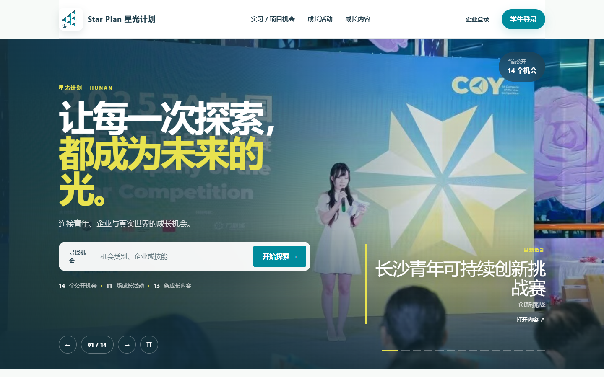

# JA 星光计划

面向青年成长、企业招募与项目运营的一体化平台。公开端提供机会、活动和成长内容，学生端沉淀简历与成长档案，企业端发布并管理内容，JA 运营端负责审核、治理和审计。

> 当前仓库为完整产品工程，不是静态展示页。它包含前台、三类工作台、服务端 API、身份认证、数据库迁移、文件存储适配和自托管部署配置。

## 实际运行效果

下面是本仓库在本地启动后的首页实拍：



## 产品角色

| 角色 | 可完成的主要任务 |
| --- | --- |
| 游客 | 浏览实习 / 项目机会、成长活动、成长内容和企业公开主页 |
| 学生 | 注册登录、维护个人资料、上传简历、收藏机会、报名活动、阅读内容、生成可分享的成长主页 |
| 企业 | 维护企业资料，创建和管理岗位、活动、成长内容及媒体素材 |
| JA 运营 | 使用独立管理密钥进入隐藏后台，审核内容、管理发布状态、维护密钥并查看审计日志 |

## 已实现功能

- 公共官网：首页轮播、实时内容指标、成长路径、影响力故事与统一导航。
- 机会中心：检索、筛选、详情页、收藏与学生邮箱直投。
- 成长活动：活动日历、详情、报名与状态持久化。
- 内容中心：图文 / 视频内容目录、详情阅读和富文本展示。
- 学生工作台：总览、机会、活动、学习中心、成长轨迹、简历和公开分享页。
- 企业工作台：岗位、活动、内容和企业资料的创建、编辑、删除与媒体上传。
- 账号系统：学生 / 企业邮箱密码注册登录、角色固定、独立会话和三步密码重置。
- 运营治理：独立管理密钥、统一审核、内容管理、密钥生命周期和操作审计。
- 数据与文件：结构化业务数据、私有简历、公开媒体文件、备份与恢复工具。
- 响应式界面：桌面与移动端共享统一的 JA 星光计划品牌系统。

## 技术栈

- React 19 + TypeScript
- Vinext / Vite 8
- Tailwind CSS 4
- Drizzle ORM
- Cloudflare D1 / SQLite 数据适配
- Cloudflare R2 / 本地文件存储适配
- Node.js 自托管运行时

## 快速开始

### 环境要求

- Node.js `>= 22.13.0`
- npm

### 安装与运行

```bash
git clone https://github.com/xingchenyd/ja-starlight.git
cd ja-starlight
npm install
cp .env.example .env.local
npm run dev
```

启动后访问终端中打印的地址，默认通常为 `http://localhost:3000`。

公开页面可以匿名浏览。需要测试学生、企业或 JA 运营流程时，请先在 `.env.local` 中配置对应的种子密码或管理密钥。

## 环境变量

完整模板见 [`.env.example`](./.env.example)。敏感值必须通过部署平台的 Secret 管理，不要提交到 Git。

| 变量 | 用途 |
| --- | --- |
| `AUTH_PEPPER` | 密码派生的全局 Pepper，每个环境必须使用独立随机值 |
| `AUTH_TRUSTED_ORIGINS` | 允许发起认证请求的源地址 |
| `AUTH_SEED_STUDENT_PASSWORD` | 初始学生账号密码 |
| `AUTH_SEED_ENTERPRISE_PASSWORD` | 初始企业账号密码 |
| `AUTH_SEED_ADMIN_KEY` | 初始 JA 运营管理密钥 |
| `MAIL_PROVIDER` | 密码重置邮件提供商 |
| `TENCENT_SES_*` / `RESEND_API_KEY` | 对应邮件服务的凭据 |
| `MAIL_FROM` / `MAIL_REPLY_TO` | 发件人与回复地址 |

未配置邮件服务时，密码重置界面仍可展示，但服务端会明确返回“邮件服务正在配置中”，不会暴露测试验证码。

## 常用命令

```bash
npm run dev          # 本地开发
npm run build        # 托管构建
npm run build:node   # Node.js 自托管构建
npm start            # 启动生产构建
npm run lint         # ESLint 检查
npm test             # 构建并运行全部测试
npm run db:generate  # 生成 Drizzle 迁移
```

## 目录结构

```text
ja-starlight/
├── app/                 # 页面、工作台、API 路由和设计系统
│   ├── api/             # 认证、目录、报名、文件、运营等接口
│   ├── workspace/       # 学生 / 企业工作台
│   ├── ja-console/      # 隐藏的 JA 运营后台
│   ├── opportunities/   # 机会目录与详情
│   ├── activities/      # 活动目录与详情
│   └── content/         # 成长内容目录与详情
├── db/                  # Drizzle schema 与运行时适配
├── drizzle/             # 数据库迁移
├── lib/auth/            # 密码、会话、授权、邮件和种子账号
├── server/              # Node.js 自托管服务器与 SQLite / 文件服务
├── worker/              # Cloudflare Worker 入口
├── scripts/             # 构建、备份、恢复与验收脚本
├── tests/               # 认证、业务、UI、迁移和自托管测试
├── deploy/              # Nginx、systemd、HTTPS、备份配置
└── docs/                # 部署说明与完整验收记录
```

## 数据与安全边界

- 一个邮箱只能绑定一种身份，学生与企业会话相互隔离。
- 密码使用随机盐和 PBKDF2-HMAC-SHA-256 派生，不保存明文。
- 会话只通过 `HttpOnly` Cookie 传递。
- 学生简历按私有文件处理；企业媒体只有审核通过后才公开。
- JA 运营密钥可停用、恢复和永久撤销，关键操作写入审计日志。
- 学生会话默认 7 天、企业会话 24 小时、运营会话 4 小时。

## 部署与验收

仓库同时支持托管运行时和 Node.js 自托管。生产部署、Nginx、systemd、HTTPS、备份和恢复步骤见 [`docs/self-hosting-runbook.md`](./docs/self-hosting-runbook.md)。

完整业务验收记录见：

- [`docs/full-platform-acceptance-20260921.md`](./docs/full-platform-acceptance-20260921.md)
- [`docs/student-profile-acceptance-20260921.md`](./docs/student-profile-acceptance-20260921.md)

## 架构演进

业务模型按用户、凭据、会话、职位、申请、活动、报名、内容、审核、文件和审计拆分。未来迁移到 NestJS + PostgreSQL 或其他对象存储时，可以保留页面、Cookie 契约和业务状态机，只替换数据库、邮件与存储适配层。
